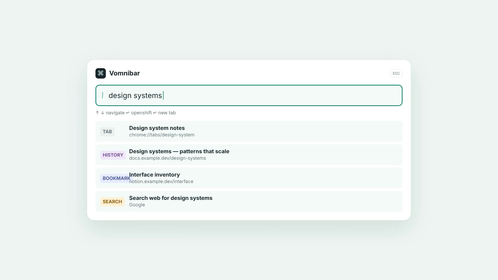

# CroVim

CroVim is a keyboard-first navigation extension for modern web browsers—including **Mozilla Firefox**, **Brave**, **Google Chrome**, **Microsoft Edge**, **Arc**, **Opera**, and other Chromium- or Gecko-based browsers—built around familiar Vim motions. It brings page scrolling, link selection, search, and tab commands to ordinary web pages while leaving browser native shortcuts untouched.

CroVim targets a unified Manifest V3 specification compatible across both Chromium and Gecko engines. The extension is written in TypeScript, bundled with Vite and esbuild, and thoroughly tested with Vitest, Playwright, and Mozilla's `web-ext`.

## Overview and design principles

CroVim treats keyboard navigation as an additional way to use the browser, not as a replacement for browser controls:

- **Cross-browser by design:** A single unified build runs smoothly on Firefox, Brave, Chrome, Edge, and Arc without platform forks.
- **Vim-style motions:** Use short keys and sequences to scroll, search, select links, and move between tabs.
- **Browser shortcuts remain untouched:** Key combinations containing Ctrl, Alt, or Meta are passed directly to the browser. Commands such as `Ctrl+1`–`Ctrl+9`, `Ctrl+T`, `Ctrl+W`, and `Ctrl+R` are never intercepted.
- **Text editing stays natural:** Navigation mappings are inactive while any text editor, form control, or `contenteditable` element has focus. `i` enters Insert mode, and `Escape` blurs editable elements and returns to Normal mode.
- **Works on dynamic single-page applications:** Hint discovery scans the live DOM and open Shadow DOM trees on demand, allowing full link navigation on client-rendered web apps such as YouTube, Facebook, GitHub, and Instagram.
- **Isolated UI:** CroVim renders its HUD, link hints, help modal, find bar, and Vomnibar inside a Shadow DOM container (`#crovim-ui-root`) so host page CSS does not break extension styles.

Content scripts run on `http://` and `https://` pages, including iframe subframes. Browsers restrict extension script injection into internal pages (e.g. `chrome://*`, `about:*`, `brave://*`).

## Keyboard shortcuts

These are the default mappings in `src/shared/settings-schema.ts`. Sequences are case-sensitive. Uppercase keys such as `F`, `G`, `N`, and `T` mean the shifted key; `F` is usually entered as `Shift+F`.

| Keys | Action |
| --- | --- |
| `j` / `k` | Scroll down / up. Deltas accumulate into a smooth animation, and holding the key repeats the motion. Automatically targets the container under the mouse pointer or deeply focused element. |
| `h` / `l` | Scroll left / right with the same additive, repeatable scrolling behavior. |
| `d` / `u` | Scroll down / up by half the viewport height. |
| `gg` / `G` | Scroll the current scroll target to the top / bottom. |
| `zH` / `zL` | Scroll the current scroll target to the left / right edge. |
| `s` / `gs` | Select a specific scroll container (div, panel, section, sidebar, or window) on multi-pane pages. Hints appear over all scrollable elements; typing a hint locks scrolling to that container with a visual outline indicator. |
| `F` (`Shift+F`) | Open link hints; selecting a candidate activates it in the current tab. Supports complex interactive controls, social reaction docks (e.g. Facebook Like/Love/Haha), modal buttons, and links. Lowercase `f` is unbound. |
| `gf` | Open link hints; selecting a link opens it in a new tab. Other hinted controls are activated on the current page. |
| `yf` | Open link hints; selecting a link copies its URL. |
| `q` / `gh` | Hover hint. Triggers realistic pointer/mouse hover on an element (e.g. hovering over the Facebook Like button to reveal the reaction dock, or preview popups) without clicking. |
| `/` | Open in-page find. Type a query, press Enter to finish, or Escape to cancel. |
| `n` / `N` | Move to the next / previous find match. Find wraps at either end. |
| `o` | Open the Vomnibar for tabs, history, bookmarks, or web search. Selecting a result opens it in the current tab; Shift+Enter opens it in a background tab. |
| `O` | Open the Vomnibar using its current-page mode flag. The current UI does not yet distinguish this mode from `o`. |
| `t` / `T` | Create a new active tab / a new background tab. |
| `x` / `X` | Close the current tab / restore the most recently closed tab. |
| `b` / `B` | Declared as back-tab / forward-tab commands, but currently have no effect because their dispatcher handlers are not implemented. |
| `gt` / `gT` | Activate the next / previous tab in the current window, wrapping at either end. |
| `g0` / `g$` | Activate the first / last tab in the current window. |
| `J` / `K` | Move the current tab right / left in the tab strip. |
| `>>` / `<<` | Also move the current tab right / left. Press the shifted `>` or `<` key twice. |
| `gu` / `gU` | Navigate to the parent path / origin root of the current URL. Query and fragment are removed. |
| `yy` | Copy the current page URL. |
| `yt` | Copy the page title followed by its URL. |
| `gi` | Focus the first visible input, textarea, or `contenteditable="true"` element. |
| `[[` / `]]` | Navigate backward / forward in the current page's history. |
| `^` | Return to the previously active tab. |
| `r` / `R` | Reload / reload while bypassing the cache. |
| `i` | Enter Insert mode and pass keys through to the page. Press Escape to return to Normal mode. |
| `Escape` | Blur a focused editable element or exit the active CroVim mode and return to Normal mode. |
| `v` / `V` | Declared as visual / visual-line commands, but currently have no effect because no content-script listener handles them. |
| `m`, backtick, `'` | Declared as set-mark / go-to-mark commands, but currently have no effect because their dispatcher handlers are not implemented. |
| `p` / `P` | Declared as open-clipboard-URL / open-clipboard-URL-in-background commands, but currently have no effect because their dispatcher handlers are not implemented. |
| `?` | Open the help dialog, which lists the configured mappings. |

### Mapping implementation notes

The rows marked as having no effect are present in the default settings, and the help dialog lists them because it displays configured mappings. Key mappings are editable in Options, but a mapping only runs when the dispatcher implements its command name; custom mappings to unhandled commands are also inert.

Counts can prefix commands; for example, `5j` issues five scroll increments and `3J` moves the current tab three positions to the right. The options page exposes a `scrollStep` preference, but the current dispatcher uses a fixed 100 CSS-pixel increment for each `j`, `k`, `h`, or `l` command. The stored `scrollStep` value does not currently change that increment.

## Installation and browser setup

### 1. Build from source

Clone or download this repository, install dependencies, and build the extension:

```sh
git clone https://github.com/penOnFire/CroVim.git
cd CroVim
npm install
npm run build
```

The output will be placed in `dist/`. To package a signed or distributable `.zip` archive (compatible with both Chrome Web Store and Firefox AMO):

```sh
npm run package
# Outputs web-ext-artifacts/crovim-0.1.0.zip
```

---

### 2. Loading into your browser

#### Mozilla Firefox (and Gecko forks: LibreWolf, Zen, Waterfox, Floorp)
1. Open Firefox and navigate to `about:debugging#/runtime/this-firefox`.
2. Click **Load Temporary Add-on...**.
3. Select `dist/manifest.json` (or the packaged archive `web-ext-artifacts/crovim-0.1.0.zip`).
4. CroVim is now active! Test it on any website (e.g. `https://en.wikipedia.org`).
5. *Developer hot-reload:* Run `npx web-ext run --source-dir dist` to launch Firefox with live auto-reload enabled.

#### Brave Browser
1. In Brave, navigate to `brave://extensions`.
2. Toggle **Developer mode** in the top-right corner.
3. Click **Load unpacked** and select the `dist/` directory from this repository.
4. *Brave Shields note:* CroVim works out of the box with Brave Shields enabled. Shields' fingerprinting or ad blocking will not interfere with keyboard motions or hints.

#### Google Chrome / Chromium / Arc
1. Open `chrome://extensions` (or `arc://extensions`).
2. Toggle **Developer mode** in the top-right corner.
3. Click **Load unpacked** and select the `dist/` folder.
4. Open any HTTP or HTTPS tab to start navigating.

#### Microsoft Edge
1. Open `edge://extensions`.
2. Enable **Developer mode** in the left sidebar menu.
3. Click **Load unpacked** and select the `dist/` directory.

---

## Architecture and cross-browser design

### Universal Manifest V3
CroVim provides a single, standards-compliant Manifest V3 configuration that works across both Chromium and Gecko browser engines:
- **Dual Background Dispatch:** Chromium browsers expect `"service_worker": "service-worker.js"`, while Firefox requires background scripts listed in `"scripts": ["service-worker.js"]`. Supplying both ensures full compatibility without needing platform-specific manifests.
- **Gecko Add-on Metadata:** Declares `"browser_specific_settings.gecko"` with ID `crovim@seanizonfire.github.io` and `"data_collection_permissions": { "required": ["none"] }` adhering to Mozilla AMO strict privacy guidelines.
- **Icon Standards:** Packed with genuine 16x16, 32x32, 48x48, and 128x128 RGBA PNG icons passing strict linter checks.

### Safe WebExtension storage & RPC shims
- **Session & Local Storage Fallback:** `chrome.storage.session` smoothly falls back to `chrome.storage.local` in environments where session storage is unavailable, preventing unhandled promise rejections.
- **Managed & Sync Storage Safety:** Preferences gracefully query `chrome.storage.managed` -> `chrome.storage.sync` -> `chrome.storage.local` with fallback resilience if user sync or managed policies are disabled.
- **Universal RPC Transport:** The RPC client auto-detects `globalThis.chrome` and `globalThis.browser` environments, delivering consistent, promise-backed typed messaging across background worker and content scripts.

### Content-script pipeline
`manifest.json` injects `content-script.js` at `document_start` on matching HTTP and HTTPS pages, in all frames, with `match_about_blank` and `match_origin_as_fallback`. The entry point loads and normalizes settings, honors excluded URL patterns, and assembles the mode manager, command trie, key-event pipeline, dispatcher, scroller, and in-page UI. Cleanup hooks prevent duplicate listeners and UI roots if the content script is reinitialized.

The key-event pipeline captures keyboard events, builds multi-key sequences, parses numeric counts, and dispatches completed commands. Ctrl, Alt, and Meta chords are left to the browser. CroVim also avoids taking normal-mode keys from editable page targets and supports configured pass-through keys.

### Modes and isolated UI
`ModeManager` tracks Normal, Insert, link-hints, find, Vomnibar, help, and other declared modes, with cleanup callbacks when a mode exits. In-page interface components are attached to `#crovim-ui-root`, which owns an open Shadow DOM root. This keeps CroVim's styles and elements separate from the host page's CSS while allowing the content script to manage them.

### Link-hint discovery and activation
`src/content/link-hints/hint-discovery.ts` walks the document and open Shadow DOM trees, looking for links, buttons, form controls, ARIA controls, focusable elements, and pointer-cursor targets. It filters hidden, disabled, off-screen, and occluded candidates using visibility checks, element bounds, and hit tests at sample points. Alphabetic labels use the configured hint characters (default: `asdfghjkl`). Selecting a label activates the target, opens a link in a new tab, or copies its URL according to the entry command.

### Smooth scrolling
`SmoothScroller` finds a scrollable target near the deeply focused or center-hovered element, checks its ancestors, then falls back to the page or a large scrollable element. Smooth movement applies part of each delta immediately and eases the accumulated remainder over animation frames. Repeated key presses add to the pending movement instead of replacing it. Disabled smooth scrolling and `prefers-reduced-motion: reduce` use direct movement; edge commands use the browser's smooth scroll behavior when enabled.

### MV3 service worker and RPC
The Manifest V3 service worker initializes tab-activation tracking and lifecycle handlers, then accepts validated runtime messages through `src/background/rpc-router.ts`. The shared RPC client assigns request IDs, applies a timeout, and returns typed success or error results. The router handles settings, tab/window operations, URL navigation, Vomnibar completion, and global marks using the extension APIs.

### Settings schema and storage
Settings use schema version `1` and are normalized against defaults in `src/shared/settings-schema.ts`. The schema covers key mappings, pass-through keys, excluded URL patterns, custom search engines, scrolling, hint labels, find behavior, theme, marks, and new-tab preferences. Invalid values are normalized and validated before a settings update is saved.

## Development, build, and testing

### Commands

| Command | Purpose |
| --- | --- |
| `npm install` | Install all build and test dependencies. |
| `npm run dev` | Start Vite's development server for extension page UI work. |
| `npm run typecheck` | Run TypeScript type checks (`tsc --noEmit`). |
| `npm run lint` | Lint the repository with ESLint. |
| `npm test` | Run Vitest unit and DOM tests once in jsdom. |
| `npm run test:watch` | Run Vitest in interactive watch mode. |
| `npm run build` | Build extension entries and pages into `dist/`, copy manifest, and validate dist. |
| `npm run package` | Package `dist/` into a ready-to-distribute zip archive via `web-ext`. |
| `npm run lint:firefox` | Run Mozilla's `web-ext lint` against `dist/` to verify AMO and Gecko MV3 standards. |
| `npm run test:firefox` | Launch Firefox in headless mode with CroVim installed and verify add-on registration. |
| `npm run test:e2e` | Build and run Playwright end-to-end tests against Chromium. |
| `npm run test:all` | Run the full verification suite: typecheck, lint, Vitest, Chromium E2E, Firefox lint, and Firefox launch. |


Vitest includes `src/**/*.test.ts` and `tests/**/*.test.ts`, covering settings validation, search engines, the command trie, DOM discovery, editables, find behavior, and key-event handling. Playwright tests live in `tests/e2e/`; they launch a persistent Chromium context with the unpacked `dist/` extension and exercise its pages, service worker, and content-script flows. If Playwright cannot find a Chromium installation on your machine, install its browser with `npx playwright install chromium`.

### Source layout

| Path | Responsibility |
| --- | --- |
| `src/content/` | Content-script lifecycle, keyboard pipeline, modes, scrolling, hints, find, Vomnibar overlay, and page UI. |
| `src/background/` | MV3 service worker, RPC routing, storage access, tab and URL commands, and completion search. |
| `src/shared/` | Settings types and schema, validation, messages, and RPC client. |
| `src/pages/` | Popup, options, help, and Vomnibar extension pages. |
| `src/styles/` | Styles injected with the content script. |
| `tests/unit/` | Unit tests for shared logic and command helpers. |
| `tests/dom/` | jsdom tests for DOM discovery and keyboard behavior. |
| `tests/e2e/` | Playwright tests that load the built extension in Chromium. |

## Launch video

[](brag-output/brag.mp4)

Open the [CroVim launch video](brag-output/brag.mp4) or view its poster at [`brag-output/brag.jpg`](brag-output/brag.jpg).
